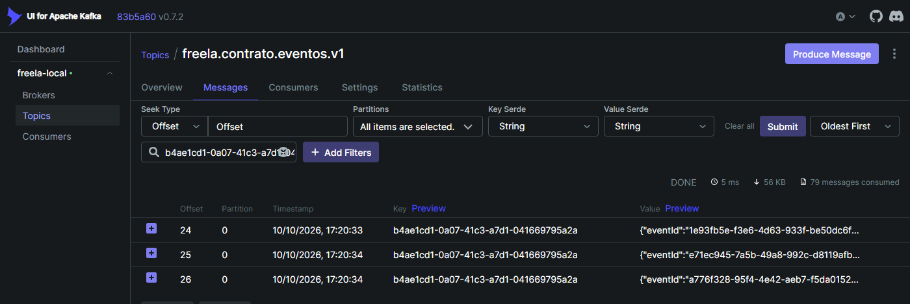
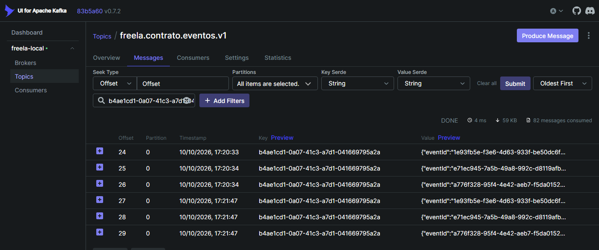
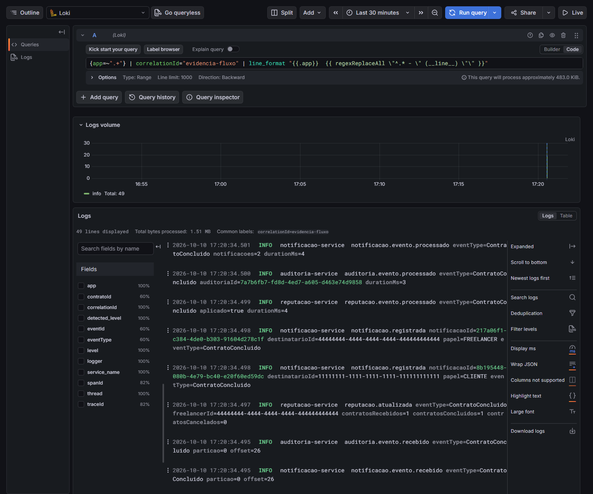
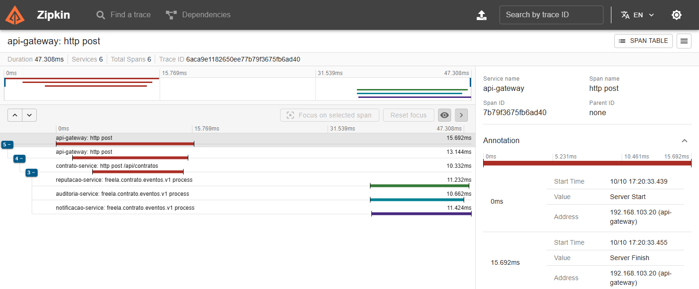

# Evidências da execução — passo a passo

## 1. Requisição recebida pelo API Gateway

```bash
curl -i -X POST http://localhost:8080/api/contratos \
  -H 'Content-Type: application/json' -H 'X-Correlation-Id: evidencia-fluxo' \
  -d '{"clienteId":"11111111-1111-1111-1111-111111111111","freelancerId":"44444444-4444-4444-4444-444444444444","titulo":"Site institucional","valor":1200.00}'
```

```text
HTTP/1.1 201 Created
Content-Type: application/json
Content-Length: 257
Date: Sat, 10 Oct 2026 20:20:33 GMT
X-Correlation-Id: evidencia-fluxo

{"id":"b4ae1cd1-0a07-41c3-a7d1-041669795a2a","clienteId":"11111111-1111-1111-1111-111111111111","freelancerId":"44444444-4444-4444-4444-444444444444","titulo":"Site institucional","valor":1200.00,"status":"ATIVO","criadoEm":"2026-10-10T20:20:33.446505101Z"}
```

```bash
curl -i -X POST http://localhost:8080/api/contratos/$ID/entrega   -H 'X-Correlation-Id: evidencia-fluxo'
curl -i -X POST http://localhost:8080/api/contratos/$ID/conclusao -H 'X-Correlation-Id: evidencia-fluxo'
```

```text
HTTP/1.1 200 OK
Content-Type: application/json
Content-Length: 267
Date: Sat, 10 Oct 2026 20:20:33 GMT
X-Correlation-Id: evidencia-fluxo

{"id":"b4ae1cd1-0a07-41c3-a7d1-041669795a2a","clienteId":"11111111-1111-1111-1111-111111111111","freelancerId":"44444444-4444-4444-4444-444444444444","titulo":"Site institucional","valor":1200.00,"status":"ENTREGA_REGISTRADA","criadoEm":"2026-10-10T20:20:33.446505Z"}

HTTP/1.1 200 OK
Content-Type: application/json
Content-Length: 258
Date: Sat, 10 Oct 2026 20:20:33 GMT
X-Correlation-Id: evidencia-fluxo

{"id":"b4ae1cd1-0a07-41c3-a7d1-041669795a2a","clienteId":"11111111-1111-1111-1111-111111111111","freelancerId":"44444444-4444-4444-4444-444444444444","titulo":"Site institucional","valor":1200.00,"status":"CONCLUIDO","criadoEm":"2026-10-10T20:20:33.446505Z"}
```

O Gateway devolve o `X-Correlation-Id` e registra cada requisição. Consulta no Grafana (`http://localhost:3000` →
Explore → Loki):

```text
{app="api-gateway"} | correlationId="evidencia-fluxo"
```

Resultado (neste documento, as linhas de log estão abreviadas: horário, serviço e mensagem):

```text
17:20:33.439 service=api-gateway gateway.requisicao.inicio metodo=POST caminho=/api/contratos
17:20:33.455 service=api-gateway gateway.requisicao.fim metodo=POST caminho=/api/contratos status=201 CREATED durationMs=15 sinal=onComplete
17:20:33.485 service=api-gateway gateway.requisicao.inicio metodo=POST caminho=/api/contratos/b4ae1cd1-0a07-41c3-a7d1-041669795a2a/entrega
17:20:33.495 service=api-gateway gateway.requisicao.fim metodo=POST caminho=/api/contratos/b4ae1cd1-0a07-41c3-a7d1-041669795a2a/entrega status=200 OK durationMs=10 sinal=onComplete
17:20:33.501 service=api-gateway gateway.requisicao.inicio metodo=POST caminho=/api/contratos/b4ae1cd1-0a07-41c3-a7d1-041669795a2a/conclusao
17:20:33.508 service=api-gateway gateway.requisicao.fim metodo=POST caminho=/api/contratos/b4ae1cd1-0a07-41c3-a7d1-041669795a2a/conclusao status=200 OK durationMs=6 sinal=onComplete
```

## 2. Alteração persistida no contrato-service

O contrato e os eventos são gravados na mesma transação: o contrato em `contratos` e um evento por transição em
`outbox_eventos`.

```bash
docker exec freela-postgres psql -U freela -d contrato_db -c "select id, status, versao from contratos where id = '$ID'"
docker exec freela-postgres psql -U freela -d contrato_db -c "select id, event_type, status, tentativas from outbox_eventos where aggregate_id = '$ID' order by id"
```

```text
                  id                  |  status   | versao 
--------------------------------------+-----------+--------
 b4ae1cd1-0a07-41c3-a7d1-041669795a2a | CONCLUIDO |      2
(1 row)

 id |    event_type     |  status   | tentativas 
----+-------------------+-----------+------------
 70 | ContratoCriado    | PUBLICADO |          1
 71 | EntregaRegistrada | PUBLICADO |          1
 72 | ContratoConcluido | PUBLICADO |          1
(3 rows)
```

## 3. Evento publicado no Kafka

Tópico `freela.contrato.eventos.v1` no Kafka UI (`http://localhost:8090`), filtrado pelo id do contrato. As três
mensagens têm a mesma chave (o `contratoId`), estão na mesma partição e em offsets consecutivos.



Os headers de cada mensagem, pela linha de comando (partição e offset vistos na tela acima):

```bash
docker exec freela-kafka /opt/kafka/bin/kafka-console-consumer.sh --bootstrap-server localhost:9092 \
  --topic freela.contrato.eventos.v1 --partition 0 --offset 24 --max-messages 3 \
  --formatter-property print.partition=true --formatter-property print.offset=true \
  --formatter-property print.headers=true --formatter-property print.key=true --formatter-property print.value=false
```

```text
Partition:0	Offset:24	eventId:1e93fb5e-f3e6-4d63-933f-be50dc6fb127,eventType:ContratoCriado,contratoId:b4ae1cd1-0a07-41c3-a7d1-041669795a2a,correlationId:evidencia-fluxo,traceparent:00-6aca9e1182650ee77b79f3675fb6ad40-a05234cb433d9b06-01	b4ae1cd1-0a07-41c3-a7d1-041669795a2a
Partition:0	Offset:25	eventId:e71ec945-7a5b-49a8-992c-d8119afb7bd2,eventType:EntregaRegistrada,contratoId:b4ae1cd1-0a07-41c3-a7d1-041669795a2a,correlationId:evidencia-fluxo,traceparent:00-6aca9e114a30d783cd7b0223a3042147-46fde8802a055a53-01	b4ae1cd1-0a07-41c3-a7d1-041669795a2a
Partition:0	Offset:26	eventId:a776f328-95f4-4e42-aeb7-f5da01520ed5,eventType:ContratoConcluido,contratoId:b4ae1cd1-0a07-41c3-a7d1-041669795a2a,correlationId:evidencia-fluxo,traceparent:00-6aca9e11b05440fe4993cdb18711dbf7-2d8225b4887c013b-01	b4ae1cd1-0a07-41c3-a7d1-041669795a2a
```

## 4. Consumo do evento pelos serviços interessados

Cada serviço consome no seu próprio grupo, então os três processam os três eventos. Consulta no Grafana:

```text
{app=~"notificacao-service|reputacao-service|auditoria-service"} | contratoId="b4ae1cd1-0a07-41c3-a7d1-041669795a2a" |= "evento.processado"
```

Resultado:

```text
17:20:33.485 service=auditoria-service auditoria.evento.processado eventType=ContratoCriado auditoriaId=52bb1ad8-d3f4-4b3d-b467-fe4787764fcd durationMs=5
17:20:33.486 service=notificacao-service notificacao.evento.processado eventType=ContratoCriado notificacoes=2 durationMs=5
17:20:33.486 service=reputacao-service reputacao.evento.processado eventType=ContratoCriado aplicado=true durationMs=5
17:20:34.491 service=reputacao-service reputacao.evento.processado eventType=EntregaRegistrada aplicado=false durationMs=2
17:20:34.493 service=auditoria-service auditoria.evento.processado eventType=EntregaRegistrada auditoriaId=4e933b2b-f7a3-4e5c-94b5-c5e495b216bd durationMs=4
17:20:34.493 service=notificacao-service notificacao.evento.processado eventType=EntregaRegistrada notificacoes=1 durationMs=4
17:20:34.499 service=reputacao-service reputacao.evento.processado eventType=ContratoConcluido aplicado=true durationMs=4
17:20:34.500 service=auditoria-service auditoria.evento.processado eventType=ContratoConcluido auditoriaId=7a7b6fb7-fd8d-4ed7-a605-d463e74d9858 durationMs=3
17:20:34.501 service=notificacao-service notificacao.evento.processado eventType=ContratoConcluido notificacoes=2 durationMs=4
```

## 5. Persistência realizada pelos consumidores

Cada consumidor grava no seu próprio banco.

```bash
docker exec freela-postgres psql -U freela -d notificacao_db -c "select tipo_evento, papel, destinatario_id from notificacoes where contrato_id = '$ID' order by criada_em"
docker exec freela-postgres psql -U freela -d reputacao_db -c "select contratos_recebidos, contratos_concluidos, contratos_cancelados, valor_total_concluido from reputacoes where freelancer_id = '44444444-4444-4444-4444-444444444444'"
docker exec freela-postgres psql -U freela -d auditoria_db -c "select sequencia, event_type, particao, kafka_offset, correlation_id from auditoria_eventos where contrato_id = '$ID' order by sequencia"
```

```text
    tipo_evento    |   papel    |           destinatario_id            
-------------------+------------+--------------------------------------
 ContratoCriado    | CLIENTE    | 11111111-1111-1111-1111-111111111111
 ContratoCriado    | FREELANCER | 44444444-4444-4444-4444-444444444444
 EntregaRegistrada | CLIENTE    | 11111111-1111-1111-1111-111111111111
 ContratoConcluido | CLIENTE    | 11111111-1111-1111-1111-111111111111
 ContratoConcluido | FREELANCER | 44444444-4444-4444-4444-444444444444
(5 rows)

 contratos_recebidos | contratos_concluidos | contratos_cancelados | valor_total_concluido 
---------------------+----------------------+----------------------+-----------------------
                   1 |                    1 |                    0 |               1200.00
(1 row)

 sequencia |    event_type     | particao | kafka_offset | correlation_id  
-----------+-------------------+----------+--------------+-----------------
        70 | ContratoCriado    |        0 |           24 | evidencia-fluxo
        71 | EntregaRegistrada |        0 |           25 | evidencia-fluxo
        72 | ContratoConcluido |        0 |           26 | evidencia-fluxo
(3 rows)
```

## 6. Tratamento de uma mensagem duplicada

Para provocar a duplicidade, os três eventos do contrato voltam a `PENDENTE` na outbox. O relay os publica de novo,
com os mesmos `eventId`.

```bash
docker exec freela-postgres psql -U freela -d contrato_db -c "update outbox_eventos set status = 'PENDENTE' where aggregate_id = '$ID'"
docker exec freela-postgres psql -U freela -d contrato_db -c "select id, event_type, status, tentativas from outbox_eventos where aggregate_id = '$ID' order by id"
```

```text
UPDATE 3

 id |    event_type     |  status   | tentativas 
----+-------------------+-----------+------------
 70 | ContratoCriado    | PUBLICADO |          2
 71 | EntregaRegistrada | PUBLICADO |          2
 72 | ContratoConcluido | PUBLICADO |          2
(3 rows)
```

O tópico passa a ter seis mensagens do contrato: as três originais e as três repetidas, em novos offsets.



Os dados dos consumidores continuam iguais aos do item 5: 5 notificações, reputação 1/1 e 3 eventos auditados.

```bash
docker exec freela-postgres psql -U freela -d notificacao_db -c "select count(*) as notificacoes from notificacoes where contrato_id = '$ID'"
docker exec freela-postgres psql -U freela -d reputacao_db -c "select contratos_recebidos, contratos_concluidos, contratos_cancelados, valor_total_concluido from reputacoes where freelancer_id = '44444444-4444-4444-4444-444444444444'"
docker exec freela-postgres psql -U freela -d auditoria_db -c "select count(*) as eventos_auditados from auditoria_eventos where contrato_id = '$ID'"
```

```text
 notificacoes 
--------------
            5
(1 row)

 contratos_recebidos | contratos_concluidos | contratos_cancelados | valor_total_concluido 
---------------------+----------------------+----------------------+-----------------------
                   1 |                    1 |                    0 |               1200.00
(1 row)

 eventos_auditados 
-------------------
                 3
(1 row)
```

Cada serviço reconheceu as três mensagens como repetidas. Consulta no Grafana:

```text
{app=~"notificacao-service|reputacao-service|auditoria-service"} | contratoId="b4ae1cd1-0a07-41c3-a7d1-041669795a2a" |= "evento.duplicado"
```

Resultado:

```text
17:21:47.228 service=notificacao-service notificacao.evento.duplicado eventType=ContratoCriado durationMs=1
17:21:47.230 service=auditoria-service auditoria.evento.duplicado eventType=ContratoCriado durationMs=1
17:21:47.230 service=reputacao-service reputacao.evento.duplicado eventType=ContratoCriado durationMs=1
17:21:47.234 service=notificacao-service notificacao.evento.duplicado eventType=EntregaRegistrada durationMs=1
17:21:47.234 service=reputacao-service reputacao.evento.duplicado eventType=EntregaRegistrada durationMs=1
17:21:47.235 service=auditoria-service auditoria.evento.duplicado eventType=EntregaRegistrada durationMs=1
17:21:47.239 service=notificacao-service notificacao.evento.duplicado eventType=ContratoConcluido durationMs=1
17:21:47.239 service=reputacao-service reputacao.evento.duplicado eventType=ContratoConcluido durationMs=1
17:21:47.241 service=auditoria-service auditoria.evento.duplicado eventType=ContratoConcluido durationMs=1
```

## 7. Manutenção da ordem dos eventos de um mesmo contrato

No contrato acompanhado, a ordem já aparece nos itens 3 e 5: mesma partição, offsets 24, 25 e 26, auditados nessa
sequência. Para mostrar a ordem com processamento concorrente, seis contratos do mesmo freelancer são criados,
entregues e concluídos **em paralelo**:

```bash
for i in 1 2 3 4 5 6; do
  (
    id=$(curl -s -X POST http://localhost:8080/api/contratos -H 'Content-Type: application/json' -H 'X-Correlation-Id: evidencia-ordem' \
      -d '{"clienteId":"11111111-1111-1111-1111-111111111111","freelancerId":"33333333-3333-3333-3333-333333333333","titulo":"Contrato '$i'","valor":100.00}' |
      grep -o '"id":"[^"]*"' | cut -d'"' -f4)
    curl -s -o /dev/null -X POST http://localhost:8080/api/contratos/$id/entrega   -H 'X-Correlation-Id: evidencia-ordem'
    curl -s -o /dev/null -X POST http://localhost:8080/api/contratos/$id/conclusao -H 'X-Correlation-Id: evidencia-ordem'
  ) &
done
wait
```

A auditoria registra a ordem em que cada evento foi processado (`sequencia`). Os contratos se espalham pelas três
partições, e em todos a ordem é a mesma:

```bash
docker exec freela-postgres psql -U freela -d auditoria_db -c "select contrato_id, min(particao) as particao, string_agg(event_type, ' > ' order by sequencia) as ordem_de_processamento from auditoria_eventos where correlation_id = 'evidencia-ordem' group by contrato_id order by particao, contrato_id"
```

```text
             contrato_id              | particao |                 ordem_de_processamento                 
--------------------------------------+----------+--------------------------------------------------------
 2d3ff921-d845-413b-a3c3-561382c37e75 |        0 | ContratoCriado > EntregaRegistrada > ContratoConcluido
 a1ba8134-c2a5-40e5-8515-070035adb9c6 |        0 | ContratoCriado > EntregaRegistrada > ContratoConcluido
 efbc5b8b-80b4-4021-90fe-49333694747d |        0 | ContratoCriado > EntregaRegistrada > ContratoConcluido
 40b99449-b8b6-4e75-8ac3-3568b07b7b06 |        1 | ContratoCriado > EntregaRegistrada > ContratoConcluido
 b17b38ab-acdb-4a27-9f27-c53f03450a74 |        1 | ContratoCriado > EntregaRegistrada > ContratoConcluido
 9d6593e1-3e28-4ad6-abbd-5df36fa50839 |        2 | ContratoCriado > EntregaRegistrada > ContratoConcluido
(6 rows)
```

Cada partição foi consumida por uma thread própria. Consulta no Grafana (tipo *Instant*), que conta os 18 eventos
recebidos pela notificação por thread:

```text
sum by (thread) (count_over_time({app="notificacao-service"} | correlationId="evidencia-ordem" |= "evento.recebido" [$__range]))
```

Resultado:

```text
      9 thread=notificacao-contrato-eventos-0-C-1
      6 thread=notificacao-contrato-eventos-1-C-1
      3 thread=notificacao-contrato-eventos-2-C-1
```

Mesmo com os contratos do freelancer em partições diferentes, nenhuma atualização da reputação se perdeu:

```bash
docker exec freela-postgres psql -U freela -d reputacao_db -c "select contratos_recebidos, contratos_concluidos, valor_total_concluido from reputacoes where freelancer_id = '33333333-3333-3333-3333-333333333333'"
```

```text
 contratos_recebidos | contratos_concluidos | valor_total_concluido 
---------------------+----------------------+-----------------------
                   6 |                    6 |                600.00
(1 row)
```

## 8. Logs da mesma operação consultados de forma centralizada

Grafana (`http://localhost:3000` → Explore → Loki), com a consulta `{app=~".+"} | correlationId="evidencia-fluxo"`.
Ela traz as 49 linhas da operação em um só lugar: 6 do gateway, 17 do `contrato-service`, 11 da notificação, 9 da
reputação e 6 da auditoria.



A tela foi capturada antes do passo de duplicidade (item 6). A consulta da captura tem um `line_format` a mais, só
para mostrar o serviço e a mensagem no lugar da linha inteira.

## 9. Trace correspondente disponível no Zipkin

Cada requisição gera um trace, e o `traceId` aparece em toda linha de log da operação. Consulta no Grafana, que traz
uma linha por requisição (criação, entrega e conclusão):

```text
{app="contrato-service"} | correlationId="evidencia-fluxo" |= "sucesso"
```

O `traceId` de cada uma das três linhas:

```text
traceId=6aca9e1182650ee77b79f3675fb6ad40
traceId=6aca9e114a30d783cd7b0223a3042147
traceId=6aca9e11b05440fe4993cdb18711dbf7
```

O primeiro é o da criação do contrato, aberto em `http://localhost:9411/zipkin/traces/6aca9e1182650ee77b79f3675fb6ad40`:



O trace começa no Gateway, passa pelo `contrato-service` e continua nos três consumidores depois da publicação no
Kafka. O Zipkin conta 6 serviços porque inclui o broker Kafka, além das 5 aplicações.

A tela é de antes do item 6. Depois da duplicidade, o mesmo trace ganha mais três spans de consumidor, porque as
mensagens repetidas carregam o mesmo `traceparent`.
